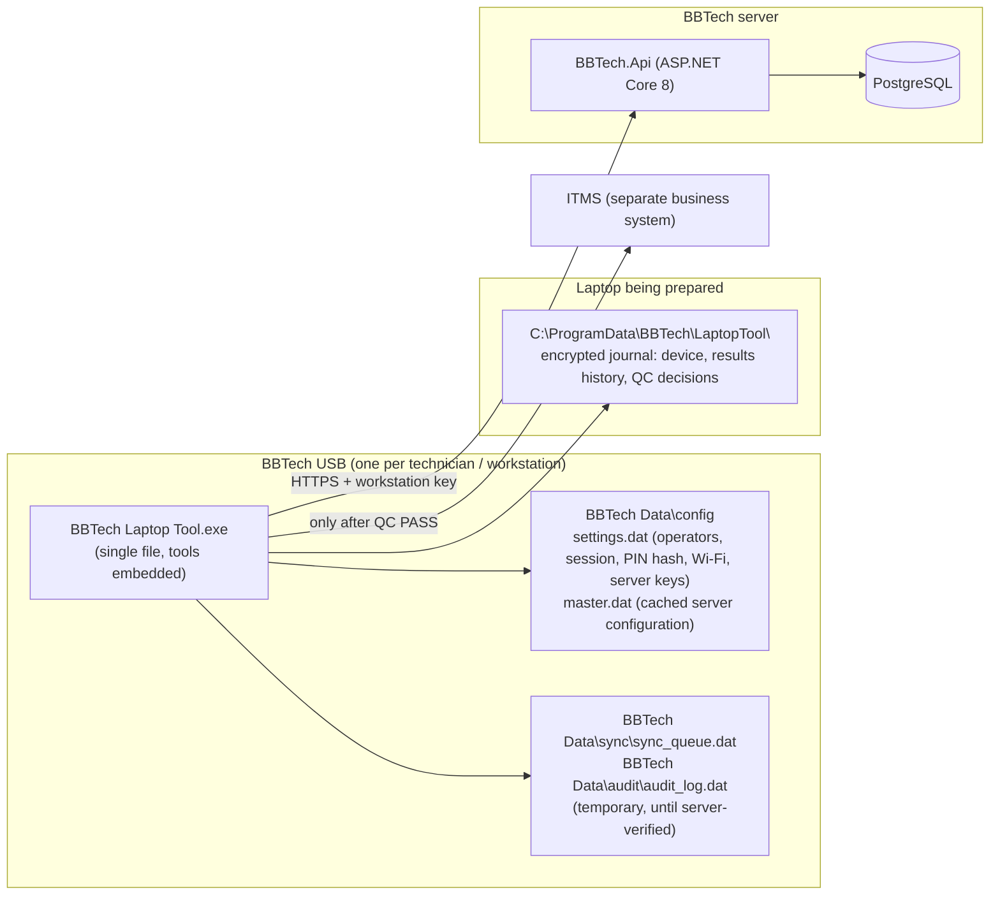
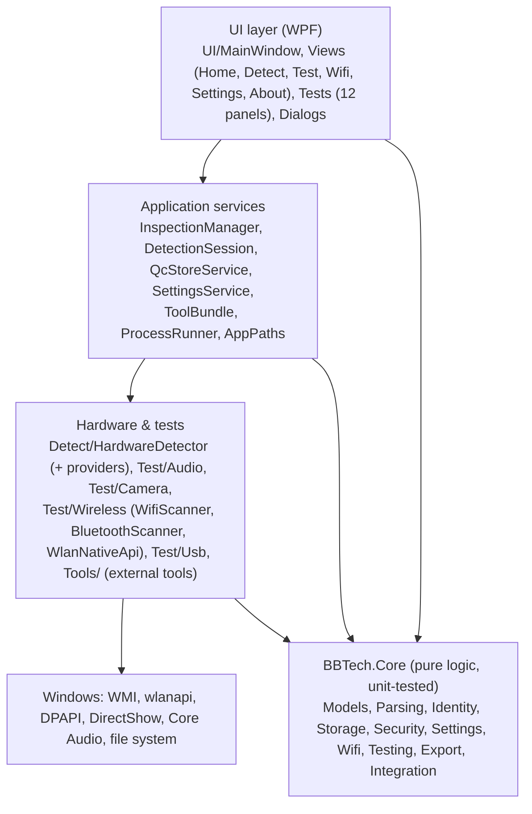
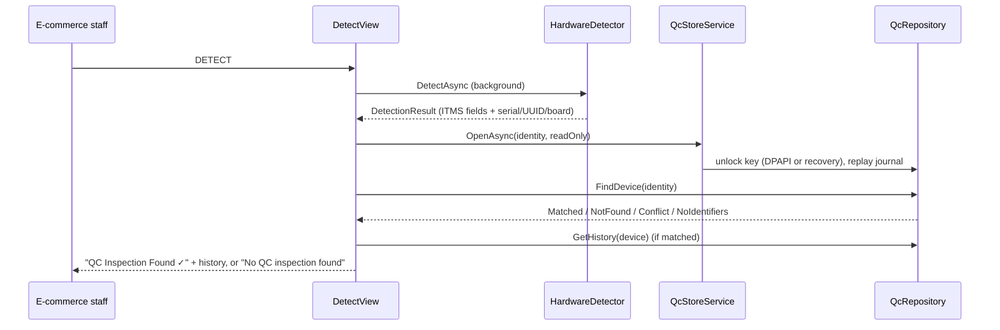

# Architecture

> Status labels: **IMPLEMENTED** = in the code today · **PLANNED** = designed for, not implemented.
> Version 1.4.0 (2026-11-25).

## 1. System overview

**IMPLEMENTED.** Workflow: operator (1-hour session) → laptop detected → Hardware → Software (checks, approved
installs, activation status) → QC (sees latest Hardware + Software, gate) → final QC decision → audit → USB queue →
server verification → safe USB cleanup → READY → ITMS. The desktop tool never connects to PostgreSQL.
See [SERVER.md](SERVER.md), [USB-SYNC.md](USB-SYNC.md).

## 2. Technology

| Item | Choice | Reason |
|---|---|---|
| Language / UI | C#, WPF | Native Windows UI, hardware APIs via WMI / P/Invoke |
| Runtime | .NET Framework 4.7.2 (`net472`) | Built into Windows 10 1803+ and Windows 11, so no runtime install and fast start-up |
| Packaging | One EXE | Core sources compiled in; third-party tools and test media embedded as resources |
| Database | Custom encrypted append-only journal | No native DLL (SQLite would need one, and encrypted SQLite a paid or third-party component); crash-safe and history-preserving |
| Tests | xUnit (`net472`) | Runs in the same framework as the app |

**External dependencies at runtime:** only Windows components (WMI, `wlanapi.dll`, `BluetoothApis.dll`, DirectShow, `winmm.dll`, Core Audio, DPAPI, Media Foundation via WPF `MediaElement`). There are no NuGet packages in the application. Test-only packages: `Microsoft.NET.Test.Sdk`, `xunit`, `xunit.runner.visualstudio`.

## 3. Layers

| Layer | Location | Responsibility |
|---|---|---|
| UI | `src/BBTech.LaptopTool/UI` | Screens, the test host window, dialogs, responsive layout |
| Application services | `src/BBTech.LaptopTool/Services` | QC workflow orchestration, store access, USB settings, tool extraction, paths |
| Hardware detection | `src/BBTech.LaptopTool/Detect` | System / CPU / memory / storage / battery providers (WMI, BatteryInfoView, fallbacks) |
| Hardware tests | `src/BBTech.LaptopTool/Test`, `UI/Tests` | Audio, camera, Wi-Fi, Bluetooth and USB services, plus the test panels |
| External tools | `src/BBTech.LaptopTool/Tools` | BatteryInfoView, HD Sentinel, Free PC Audit adapters |
| Domain logic | `src/BBTech.Core` | Parsers, identity and matching, encrypted store, settings, Wi-Fi provisioning logic, test plan, reports |
| Logging | `src/BBTech.LaptopTool/Logging/AppLog.cs` | `BBTech Data\logs\app.log`, 2 MB rotation, path and user-name scrubbing |

`BBTech.Core` has no UI and no hardware access. Hardware-dependent parts sit behind interfaces where logic needs testing: `IMachineKeyProtector` for DPAPI, and `IWlanApi` for Windows Wi-Fi.

## 4. Main data flows

### DETECT (IMPLEMENTED)

### TEST / QC (IMPLEMENTED)

1. `TestView` loads the selected operator from the USB settings and calls `InspectionManager.InitializeAsync`. That runs detection, opens or creates the store, and matches the device, which can lead to resume or conflict decisions.
2. The first recorded result starts an inspection: operator snapshot, test mode, selected tests.
3. Every result calls `QcRepository.SaveResult`, which appends to the journal and flushes it to disk.
4. **COMPLETE INSPECTION** records the final selection and results, sets the overall result, appends the completion and a LOCAL_ONLY `SyncRecord`. The inspection is then immutable.

### Wi-Fi provisioning (IMPLEMENTED)

`SettingsStore` (encrypted USB file) → `WifiProvisioner` → `WlanNativeApi.SetProfile` → read the profile back → verify `connectionMode=auto` → record a settings fingerprint (no password) in the laptop's store.

## 5. Configuration

| Setting | Where | Notes |
|---|---|---|
| Operators, 1-hour session, admin PIN hash, Wi-Fi, ITMS + BBTech server address/keys | `BBTech Data\config\settings.dat` (USB) | Encrypted and authenticated; Settings needs the admin PIN |
| Master configuration (operators, test definitions, approved packages, laptop models) | Server → cached in `BBTech Data\config\master.dat` | Server is authoritative online; the cache is used offline; older versions never replace newer ones |
| Server address | Settings → BBTech Server, or `BBTECH_API_URL` / `BBTECH_API_KEY` | HTTPS only (HTTP allowed for localhost) |
| Approved installers | `BBTech Data\installers\` (USB) or the package's offline folder | Only packages from the master configuration |
| Data / log folders | Next to the EXE (`BBTech Data\`) | Falls back to `%LOCALAPPDATA%\BBTech Laptop Tool\` if the USB is write-protected |

## 6. Error handling

- A global UI exception handler logs the error and shows a friendly message without crashing (`App.xaml.cs`). Unobserved task exceptions are logged.
- Each detection step is isolated. A failure becomes a plain-language note, and the field shows "Unknown".
- Missing hardware or tools produce messages such as "Not available on this laptop." or "Battery information is currently unavailable.", never raw error codes.
- **Store problems** (permission denied, unreadable key) mean TEST still runs, with a banner stating that results cannot be saved to the history. DETECT shows the reason. Existing data is never overwritten.

## 7. Server and synchronization (IMPLEMENTED)

- Server: `server/BBTech.Api` + PostgreSQL schema in `server/BBTech.Api/Migrations` ([SERVER.md](SERVER.md)).
- Client: `BBTech.Core.Sync` (`BBTechApiClient`, `UsbSyncQueue`, `SyncCoordinator`, `MasterConfigCache`) and
  `LaptopTool/Services` (`UsbSyncService`, `MasterDataService`) ([USB-SYNC.md](USB-SYNC.md)).
- Authorization is enforced in the client service layer (`ResultAuthorization`) **and** again on the server with
  server data. QC rules: `BBTech.Core.Testing.QcGate` / `QcRequirements` and the server's `ServerQcGate`.
