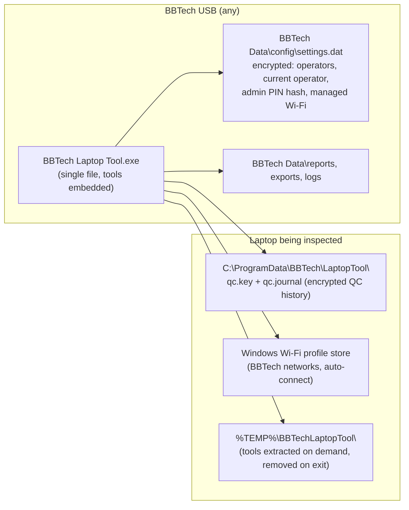
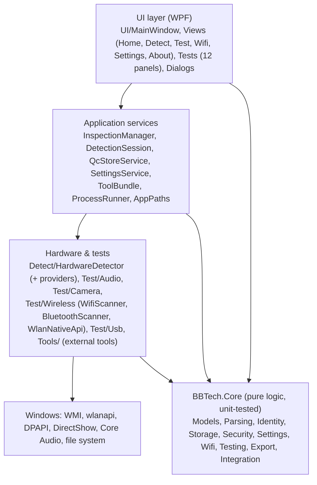
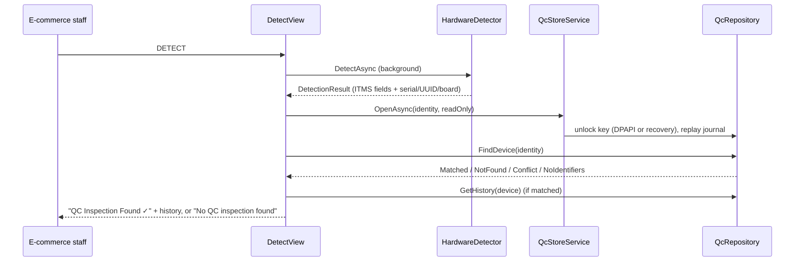

# Architecture

> Status labels: **IMPLEMENTED** = in the code today · **PLANNED** = designed for, not implemented.

## 1. System overview

**IMPLEMENTED.** The QC history lives on the laptop, never on the USB. The USB carries the program and staff/admin settings only.

## 2. Technology

| Item | Choice | Reason |
|---|---|---|
| Language / UI | C#, WPF | Native Windows UI, hardware APIs via WMI / P/Invoke |
| Runtime | .NET Framework 4.7.2 (`net472`) | Built into Windows 10 1803+ and Windows 11, so no runtime install and fast start-up |
| Packaging | One EXE | Core sources compiled in; third-party tools and test media embedded as resources |
| Database | Custom encrypted append-only journal | No native DLL (SQLite would need one, and encrypted SQLite a paid or third-party component); crash-safe and history-preserving |
| Tests | xUnit (`net472`) | Runs in the same framework as the app |

**External dependencies at runtime:** only Windows components (WMI, `wlanapi.dll`, `BluetoothApis.dll`, DirectShow, `winmm.dll`, Core Audio, DPAPI, Media Foundation via WPF `MediaElement`). There are no NuGet packages in the application. Test-only packages: `Microsoft.NET.Test.Sdk`, `xunit`, `xunit.runner.visualstudio`.

## 3. Layers

| Layer | Location | Responsibility |
|---|---|---|
| UI | `src/BBTech.LaptopTool/UI` | Screens, the test host window, dialogs, responsive layout |
| Application services | `src/BBTech.LaptopTool/Services` | QC workflow orchestration, store access, USB settings, tool extraction, paths |
| Hardware detection | `src/BBTech.LaptopTool/Detect` | System / CPU / memory / storage / battery providers (WMI, BatteryInfoView, fallbacks) |
| Hardware tests | `src/BBTech.LaptopTool/Test`, `UI/Tests` | Audio, camera, Wi-Fi, Bluetooth and USB services, plus the test panels |
| External tools | `src/BBTech.LaptopTool/Tools` | BatteryInfoView, HD Sentinel, Free PC Audit adapters |
| Domain logic | `src/BBTech.Core` | Parsers, identity and matching, encrypted store, settings, Wi-Fi provisioning logic, test plan, reports |
| Logging | `src/BBTech.LaptopTool/Logging/AppLog.cs` | `BBTech Data\logs\app.log`, 2 MB rotation, path and user-name scrubbing |

`BBTech.Core` has no UI and no hardware access. Hardware-dependent parts sit behind interfaces where logic needs testing: `IMachineKeyProtector` for DPAPI, and `IWlanApi` for Windows Wi-Fi.

## 4. Main data flows

### DETECT (IMPLEMENTED)

### TEST / QC (IMPLEMENTED)

1. `TestView` loads the selected operator from the USB settings and calls `InspectionManager.InitializeAsync`. That runs detection, opens or creates the store, and matches the device, which can lead to resume or conflict decisions.
2. The first recorded result starts an inspection: operator snapshot, test mode, selected tests.
3. Every result calls `QcRepository.SaveResult`, which appends to the journal and flushes it to disk.
4. **COMPLETE INSPECTION** records the final selection and results, sets the overall result, appends the completion and a `SyncRecord` in state `LOCAL`. The inspection is then immutable.

### Wi-Fi provisioning (IMPLEMENTED)

`SettingsStore` (encrypted USB file) → `WifiProvisioner` → `WlanNativeApi.SetProfile` → read the profile back → verify `connectionMode=auto` → record a settings fingerprint (no password) in the laptop's store.

## 5. Configuration

| Setting | Where | Notes |
|---|---|---|
| Operators, current operator, admin PIN hash, managed Wi-Fi networks | `BBTech Data\config\settings.dat` (USB) | Encrypted and authenticated; edited via Settings (admin PIN) |
| Data / log folders | Next to the EXE (`BBTech Data\`) | Falls back to `%LOCALAPPDATA%\BBTech Laptop Tool\` if the USB is write-protected |
| Tool override | `tools\<ToolName>\` next to the EXE | Optional; replaces the embedded copy (e.g. a licensed HD Sentinel Portable) |
| Test media override | `tests\SpeakerTest.mp4` next to the EXE | Optional |

There are no registry settings, environment variables or external config services.

## 6. Error handling

- A global UI exception handler logs the error and shows a friendly message without crashing (`App.xaml.cs`). Unobserved task exceptions are logged.
- Each detection step is isolated. A failure becomes a plain-language note, and the field shows "Unknown".
- Missing hardware or tools produce messages such as "Not available on this laptop." or "Battery information is currently unavailable.", never raw error codes.
- **Store problems** (permission denied, unreadable key) mean TEST still runs, with a banner stating that results cannot be saved to the history. DETECT shows the reason. Existing data is never overwritten.

## 7. Future (PLANNED, not implemented)

- **Live ITMS connection:** the architecture is IMPLEMENTED (`ItmsDevicePayload`, `ItmsSubmission` with request id, `IItmsConnector`, `TransmissionState`, `ItmsTransmissionService`). The shipped `DisabledItmsConnector` makes no network calls. A real connector is PLANNED once the ITMS endpoint and authentication are final; see [ITMS-INTEGRATION.md](ITMS-INTEGRATION.md). The flow is one physical laptop → one device payload → one send; batch processing belongs to ITMS.
- **Schema versioning** (IMPLEMENTED): journal entries carry a schema version; older entries are upgraded in memory, newer ones make the store read-only; see [DATA-MODEL.md](DATA-MODEL.md) §4.
- **Remote or cloud storage:** not planned for the local workflow.
