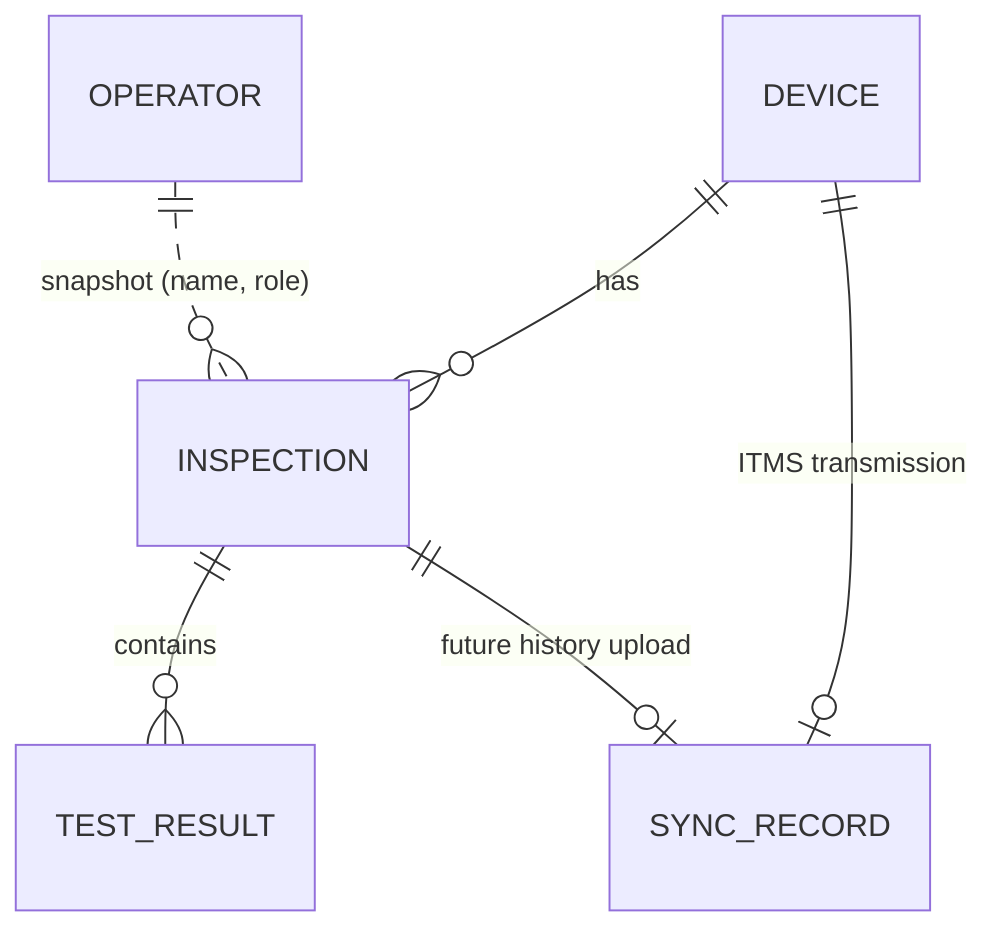

# Data Model

How BBTech Laptop Tool models physical laptops, inspections, test results, operators and future ITMS transmission. File locations, journal format and encryption are in [DATA-STORAGE.md](DATA-STORAGE.md). Code: `src/BBTech.Core/Storage/QcModels.cs`, `QcSchema.cs`, `QcRepository.cs`, `src/BBTech.Core/Settings/ToolSettings.cs`.

## 1. Principles

- **The laptop's local store is the source of truth.** QC history lives in `C:\ProgramData\BBTech\LaptopTool\` on the inspected laptop, never only on the USB and never only next to the EXE.
- **A physical device is not an inspection.** One device has many inspections. Starting a new inspection never overwrites an earlier one.
- **History is append-only.** Every change is a new encrypted journal entry. Completed inspections are immutable.
- **Reports are exports, not the source of truth.**
- **No ITMS ids.** Nothing in the model stores ITMS reference ids (brand_id, model_id …).

## 2. Entities

### DEVICE (`DeviceRecord`)

| Field | Notes |
|---|---|
| `DeviceId` | Random id (GUID) |
| `SerialNumber`, `SystemUuid`, `BoardSerial` | Cleaned firmware identifiers. Placeholders are stored as null |
| `SerialHash`, `UuidHash`, `BoardSerialHash` | Used for matching ([DEVICE-IDENTITY.md](DEVICE-IDENTITY.md)) |
| `HardwareFingerprint` | SHA-256 over the manufacturer and the stable identifier hashes. Null when the laptop has no stable identifier |
| `Manufacturer`, `Model`, `ModelNumber` | Brand, model line and model number, kept separate (`Dell` / `Latitude` / `5420`) |
| `Specs` | Latest hardware summary: `Cpu`, `Generation`, `Ram`, `Storage`, `BatteryHealth` |
| `IdentityNote` | Set only when staff created a record despite an identity conflict |
| `CreatedAt`, `UpdatedAt` | |

### INSPECTION (`InspectionRecord`)

| Field | Notes |
|---|---|
| `InspectionId`, `DeviceId`, `Number` | `Number` is 1, 2, 3 … per device |
| `OperatorId`, `OperatorNameSnapshot`, `OperatorRoleSnapshot` | Copied when the inspection starts. Renaming or deactivating an operator later never changes them |
| `Status` | `IN_PROGRESS`, `COMPLETED`, or `ABANDONED` (unfinished and not resumed; kept) |
| `OverallStatus` | `PASS`, `FAIL` or `INCOMPLETE` |
| `TestMode`, `SelectedTests` | `Required` / `AllTests` and exactly the tests selected |
| `Specs` | Hardware summary at the time of the inspection |
| `AppVersion`, `StartedAt`, `CompletedAt`, `CreatedAt`, `UpdatedAt` | |

### TEST_RESULT (`TestResultRecord`)

| Field | Notes |
|---|---|
| `TestResultId`, `InspectionId`, `TestId`, `TestName` | `TestId` is the stable key (`Keyboard`, `Speaker` …) |
| `Status` | `NOT TESTED`, `TESTING`, `PASS`, `FAIL` or `SKIPPED` |
| `Required` | True when the test is selected for the inspection |
| `Comment`, `Details`, `StartedAt`, `CompletedAt` | |

Every state change of a test is saved immediately.

### OPERATOR (`OperatorRecord`, on the USB)

`OperatorId`, `Name`, `Role`, `Active`, `CreatedAt`, `UpdatedAt`. Operators are managed data in the encrypted USB settings (Settings → Operators, admin PIN). No name is hard-coded. Deactivated operators are hidden from new inspections but stay known, so history still resolves. See [OPERATOR-MANAGEMENT.md](OPERATOR-MANAGEMENT.md).

### FUTURE_SYNC_RECORD (`SyncRecord`)

| Field | Notes |
|---|---|
| `SyncId`, `EntityType`, `EntityId` | `EntityType` is `device` (a laptop sent to ITMS) or `inspection` (future QC history upload) |
| `SyncStatus` | `LOCAL`, `READY_TO_SEND`, `SENDING`, `SENT`, `ITMS_RECEIVED` or `FAILED` ([ITMS-INTEGRATION.md](ITMS-INTEGRATION.md) §6) |
| `RequestId` | UUID of the current send operation (idempotency key). Reused for retries |
| `AttemptCount`, `LastAttemptAt`, `LastError` | `LastError` is staff-readable text only |
| `RemoteId` | The ITMS receipt reference. Set only in `ITMS_RECEIVED` |
| `UpdatedAt` | |

A device's record is created in `LOCAL` the first time its transmission state is asked for. A completed inspection gets one in `LOCAL` automatically. No network code exists, so nothing leaves `LOCAL` in the shipped application.

### Wi-Fi provisioning state (`WifiProvisionRecord`)

`Ssid`, `SettingsFingerprint` (keyed hash; **no password**), `AllUsers`, `ProvisionedAt`. It records which version of a managed network was installed on this laptop.

## 3. Status rules

| Rule | Where |
|---|---|
| Overall: any selected test FAIL → FAIL; all selected PASS → PASS; otherwise INCOMPLETE | `OverallResultCalculator` |
| A selected test that is NOT TESTED, TESTING or SKIPPED prevents PASS | Same |
| Unselected tests are not counted and are not treated as tested | `TestPlan`, reports |
| The four required tests (Display, Sound, Keyboard, Battery) cannot be removed | `TestPlan` |
| ALL TESTS selects every test in `HardwareTest`, including tests added later | `TestCatalog.All` |
| Completed inspections cannot be changed | `QcRepository` (write rejected, ignored on replay) |
| ITMS_RECEIVED only from SENT and only with an ITMS receipt | `TransmissionState` |

## 4. Schema versioning and migrations

Every journal entry carries `SchemaVersion` (`QcSchema.Current`, currently **2**). Entries written before versioning have none and count as version 1.

| Version | Change |
|---|---|
| 1 | Initial format |
| 2 | ITMS transmission states replace `LOCAL_ONLY` / `SYNC_PENDING` / `SYNCING` / `SYNCED` / `SYNC_FAILED`. Sync records gain `RequestId` and `UpdatedAt` |

How the migration works:

1. **In memory only.** While the journal is replayed, older entries are upgraded by `QcSchema.Upgrade`. The file is never rewritten, so a migration cannot destroy history.
2. **Backup first.** When a journal containing older entries is opened, a one-time copy `qc.journal.schema-v<N>.bak` is made next to it before anything new is written. The copy is never overwritten and the application never deletes it. It is as encrypted as the original.
3. **Newer data is protected.** A journal that contains entries from a newer version is opened **read-only**. DETECT still shows the history, TEST runs without saving, and every write is refused with a clear message. An older copy of the tool therefore cannot damage data it does not understand.
4. **New optional fields** (for example `TestMode` and `SelectedTests` earlier) are added as optional data members. Older records read them as empty.

## 5. Data safety

- The application never deletes QC history, Wi-Fi provisioning state or backups.
- A crash or USB removal during an inspection leaves it `IN_PROGRESS`. The next TEST offers Resume or Start new, and both keep it.
- A crash during an ITMS send leaves the record in `SENDING`. `RecoverInterrupted` turns it into `FAILED`, never into received.
- Damaged journal records are skipped and counted, and later records are still read ([DATA-STORAGE.md](DATA-STORAGE.md) §4).
