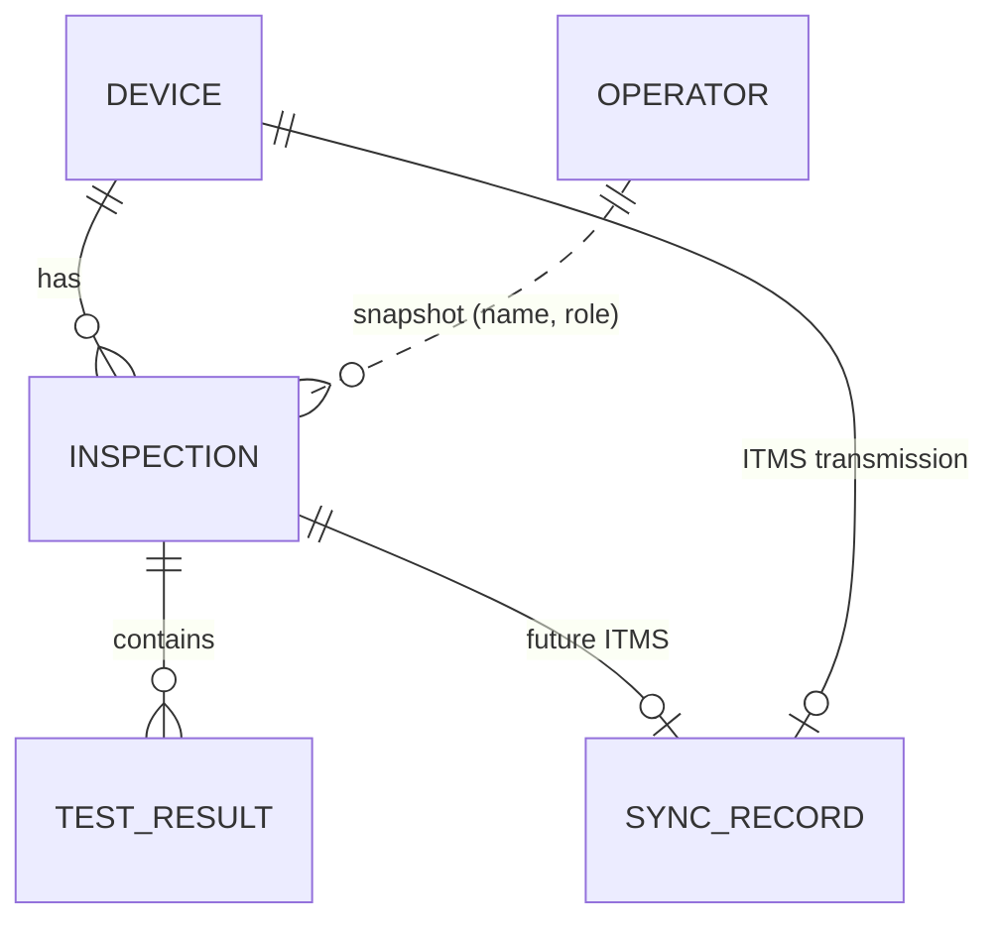

# Data Storage

All statements on this page were verified against `src/BBTech.Core/Storage`, `src/BBTech.Core/Security` and `src/BBTech.LaptopTool/Services/QcStoreService.cs`.

## 1. Locations

| Data | Location | Created by |
|---|---|---|
| QC history (devices, inspections, results, sync bookkeeping, Wi-Fi provisioning state) | `C:\ProgramData\BBTech\LaptopTool\qc.journal` | TEST (first use); Wi-Fi provisioning |
| Wrapped data key | `C:\ProgramData\BBTech\LaptopTool\qc.key` (+ `qc.key.bak`) | Same |
| Schema backup (one-time copy of a journal with older entries) | `C:\ProgramData\BBTech\LaptopTool\qc.journal.schema-v<N>.bak` | First open after a schema upgrade |
| Operators, current operator, admin PIN hash, managed Wi-Fi networks | USB: `BBTech Data\config\settings.dat` (+ `.bak`) | Settings / operator selection |
| Exported reports | USB: `BBTech Data\reports\`, `BBTech Data\exports\` | Only when Export is clicked |
| Log | USB: `BBTech Data\logs\app.log` (rotated at 2 MB to `app.1.log`) | Always |

- **DETECT is read-only:** it opens the store in read-only mode and **does not create** the folder on a laptop that was never tested.
- **Folder protection:** the folder `C:\ProgramData\BBTech\LaptopTool` and its parent `BBTech` are created with inheritance removed. Access is SYSTEM and Administrators (full control) and Authenticated Users (modify, required because the app runs as a normal user). The folders are marked Hidden, which is cosmetic only.
- **Nothing is deleted:** the application **never deletes** QC data.

## 2. Data model



| Entity | Key fields (`QcModels.cs`) |
|---|---|
| **DeviceRecord** | DeviceId, SerialNumber, SystemUuid, BoardSerial, SerialHash, UuidHash, BoardSerialHash, HardwareFingerprint, Manufacturer, Model, ModelNumber, Specs (Cpu, Generation, Ram, Storage, BatteryHealth), IdentityNote, CreatedAt, UpdatedAt |
| **InspectionRecord** | InspectionId, DeviceId, Number (1, 2, 3… per device), OperatorId, OperatorNameSnapshot, OperatorRoleSnapshot, Status (IN_PROGRESS / COMPLETED / ABANDONED), OverallStatus (PASS / FAIL / INCOMPLETE), AppVersion, Specs snapshot, TestMode (Required / AllTests), SelectedTests, StartedAt, CompletedAt, CreatedAt, UpdatedAt |
| **TestResultRecord** | TestResultId, InspectionId, TestId, TestName, Status (NOT TESTED / TESTING / PASS / FAIL / SKIPPED), Required (= selected), Comment, Details, StartedAt, CompletedAt |
| **SyncRecord** | SyncId, EntityType (device / inspection), EntityId, SyncStatus (LOCAL / READY_TO_SEND / SENDING / SENT / ITMS_RECEIVED / FAILED), RequestId, AttemptCount, LastAttemptAt, LastError, RemoteId (ITMS receipt), UpdatedAt |
| **WifiProvisionRecord** | Ssid, SettingsFingerprint (keyed HMAC, no password), AllUsers, ProvisionedAt |
| **OperatorRecord** (USB settings, not in the laptop store) | OperatorId, Name, Role, Active, CreatedAt, UpdatedAt |

Example values in this documentation use placeholders such as `SERIAL-EXAMPLE` and `UUID-EXAMPLE`.

## 3. Journal format (append-only)

```
"BBQCJ001"                                   file header (8 bytes)
"BQR1" | int32 length | encrypted payload     record 1
"BQR1" | int32 length | encrypted payload     record 2
...
```

- **Payload:** `EnvelopeCrypto` output, `[0x01][IV 16][AES-256-CBC ciphertext][HMAC-SHA256 32]`, over a JSON `JournalEntry` (Kind = device | inspection | result | sync | wifi).
- **Every change is a new record.** The current state is rebuilt by replaying the journal.
- **Persistence:** each append is flushed to disk (`FileStream.Flush(true)`) before the call returns, so a test result is durable the moment it is recorded.
- **Immutability:** once an inspection is COMPLETED or ABANDONED, later entries for it are ignored on replay, and writes are rejected with `InvalidOperationException`.
- **Validation before writing:** a test result must have a test id and one of the status labels NOT TESTED / TESTING / PASS / FAIL / SKIPPED. Completing requires PASS, FAIL or INCOMPLETE. A Wi-Fi provisioning record needs an SSID. Invalid calls are rejected and nothing is appended.
- **One record per laptop:** `RegisterDevice` refuses to create a second device record for a laptop that already matches one. On an identity conflict it only does so when staff confirmed it, which stores an `IdentityNote`.

## 4. Recovery and integrity

| Situation | Behaviour |
|---|---|
| Power loss or crash during a write | The incomplete final record is detected on the next open and cut off; all earlier records remain. If the file cannot be written at that moment (read-only copy, permissions), the history is still read and the tail is cut on a later open |
| A damaged record (bit flip, tampering) | Fails HMAC and is skipped; the reader resynchronises on the next record marker, so later records survive. The count is reported. |
| Garbage or non-journal file | Not readable; reported, not overwritten |
| App closed mid-inspection | The inspection stays IN_PROGRESS; the next TEST on that laptop offers **Resume** or **Start new** (the old one becomes ABANDONED, still kept) |
| `qc.key` missing while a journal exists | Reported as "key missing"; the journal is **not** overwritten |
| Key file damaged | `qc.key.bak` (previous version kept by the atomic replace) is tried |

All of these behaviours are covered by unit tests in `tests/BBTech.Core.Tests/QcStoreTests.cs`, `JournalTests.cs`, `KeyVaultTests.cs` and `RepositoryRulesTests.cs`.

## 5. Encryption and keys

Summary (details in [SECURITY.md](SECURITY.md)): a random 64-byte data key encrypts the journal. It is wrapped by Windows DPAPI (LocalMachine) and by recovery locks derived from each stable hardware identifier, so the same physical laptop can recover the key if DPAPI changes. **No key or secret is documented or stored in plaintext.**

## 6. Backup, migration and versioning

- **Versioning:** every journal entry carries a schema version (currently 2). The journal header (`BBQCJ001`), envelope version byte (`0x01`), key-file model `Version = 1` and settings magic (`BBTS0001`) allow future format changes.
- **Migration:** older entries are upgraded in memory while the journal is replayed; the file is never rewritten. Before new data is appended to a journal with older entries, a one-time copy `qc.journal.schema-v<N>.bak` is made. A journal with entries from a newer version opens read-only. Details: [DATA-MODEL.md](DATA-MODEL.md) §4.
- **Backup:** there is no automatic backup of the laptop store (**not implemented**). A Windows reset or reinstall that deletes `C:\ProgramData\BBTech\LaptopTool` erases the history, and a local-only design cannot recover it. Future ITMS sync is the intended off-laptop copy.
