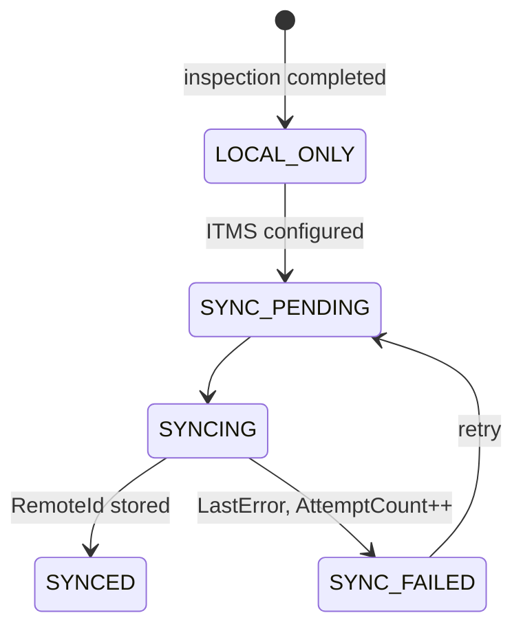

# ITMS Integration

**Status: NOT IMPLEMENTED.** The application makes **no network calls**. Only the extension points below exist in code (`src/BBTech.Core/Integration/ItmsIntegration.cs`). The ITMS API has not been defined.

## What exists (IMPLEMENTED as scaffolding only)

| Item | Purpose |
|---|---|
| `IItmsClient` / `NotConfiguredItmsClient` | Future "DETECT → Send to ITMS → New Device". The shipped client always returns "ITMS integration is not configured yet." |
| `ItmsPayload.Build` | Builds the agreed JSON body: `brand, model, model_number, cpu, generation, ram, storage, battery_health` |
| `ISyncService` / `LocalOnlySyncService` | Future upload of QC history. The shipped service never touches the network and leaves records `LOCAL_ONLY`. |
| `SyncRecord` | Stored per completed inspection: `SyncStatus`, `AttemptCount`, `LastAttemptAt`, `LastError`, `RemoteId` |
| **Send to ITMS** button in DETECT | Visible but disabled |

Every completed inspection already gets a `SyncRecord` with status `LOCAL_ONLY`.

## Planned flow (PLANNED)

## Open questions (to be decided before implementation)

- ITMS endpoint, authentication method and how credentials are provisioned (they must **not** be committed or stored in plaintext).
- Device de-duplication key on the ITMS side (serial, UUID, internal hash).
- Whether history uploads happen from TEST, DETECT, or both, and the offline retry policy.

## Why it matters

The local store cannot survive a Windows reset or disk replacement ([SECURITY.md](SECURITY.md) §3). ITMS sync is the planned way to keep a copy of the QC history off the laptop.
