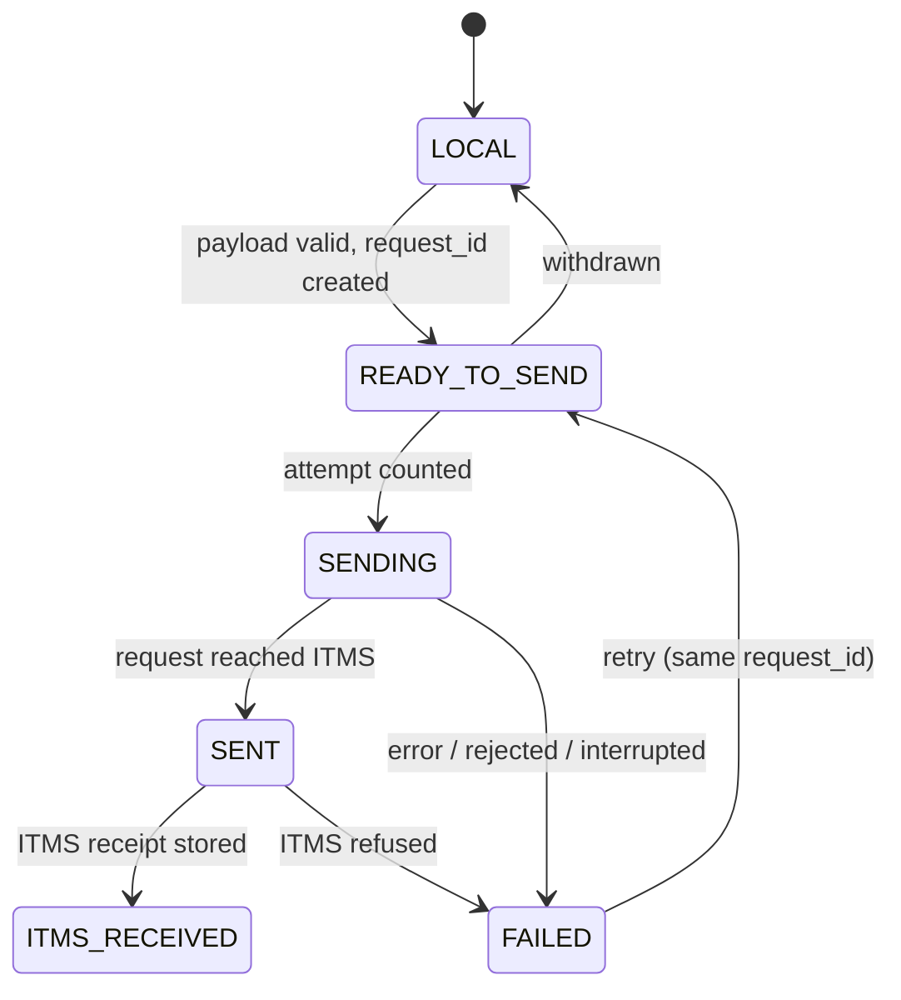

# ITMS Integration

> **Status: architecture only.** The integration architecture, the payload contract and the transmission states exist in code and are covered by unit tests. **The live ITMS connection is intentionally not enabled yet.** The application has no ITMS URL setting, no ITMS login or authentication, no HTTP client, no Supabase connection and makes no network request to ITMS. API details will be added here after the ITMS endpoint and authentication are finalised.

## 1. Workflow: one physical laptop at a time

```
USB + BBTech Laptop Tool → ONE physical laptop → DETECT → prepare ONE device payload → send to ITMS → ITMS confirms receipt → done
                                                                                                            ↓
                                                                     USB moves to the next laptop → DETECT → send → repeat
```

- **One physical laptop → one device payload → one send operation.**
- The Laptop Tool never collects several laptops locally to send them together. No screen offers batch collection.
- ITMS gathers the laptops it receives in its **Registration Queue**. Reviewing one by one, selecting several, bulk-filling common fields, individual corrections, batch registration, Group SKU and barcode SKU generation, saving and printing all happen **in ITMS**.

## 2. Responsibility boundaries

| BBTech Laptop Tool | ITMS |
|---|---|
| Hardware detection, device identity and fingerprint | Duplicate detection (decides whether a laptop is already known) |
| Local QC history, operators, Wi-Fi, local security | Registration Queue, review, bulk edit |
| Preparing the device payload (plain detected values) | Reference id resolution (brand, model, CPU, RAM, storage, generation, source) |
| Transport, request id, transmission state | Inventory registration, source / purchase-cost / status logic, validation |
| | Group SKU, barcode SKU, saving, printing, all ITMS business rules |

The Laptop Tool does not copy any ITMS business rule. The only check it makes before sending is that the laptop has a serial number, because the serial number is the primary identity of the physical laptop.

## 3. Code (IMPLEMENTED)

All in `src/BBTech.Core/Integration/`:

| Type | Purpose |
|---|---|
| `ItmsDevicePayload` | The semantic payload of one laptop: `From(DetectionResult)` for the live detection, `From(DeviceRecord)` for the stored device |
| `ItmsSubmission` | One send operation: `request_id` + one device |
| `ItmsBatchPayload` | `request_id` + several devices. **Future transport capability only**; not used by any screen |
| `IItmsConnector` | Transport contract: `PrepareDevice`, `PrepareBatch`, `SendDeviceAsync`, `SendBatchAsync`, `GetStatusAsync`, `RetryAsync`, `IsEnabled` |
| `ItmsConnectorBase` | Offline payload preparation shared by every connector |
| `DisabledItmsConnector` | **The connector shipped today.** Prepares payloads; every transport call returns `NotEnabled`. It contains no network code and never reports success |
| `ItmsSendResult` / `ItmsSendOutcome` | Transport answer: `NotEnabled`, `RequestSent`, `Received` (needs an ITMS receipt), `Rejected`, `Failed` |
| `TransmissionState` | States, allowed transitions and the rules attached to them |
| `ItmsTransmissionService` | The per-laptop flow on top of the local store: `ResolveLaptop`, `SendOrContinueAsync` (the one action behind the button), `MarkReady`, `SendAsync`, `CheckReceiptAsync`, `RetryAsync`, `RecoverInterrupted` |

In the app (`src/BBTech.LaptopTool`):

| Item | Purpose |
|---|---|
| **DETECT → Send to ITMS** | Enabled after detection. Opens the Send to ITMS window for this laptop |
| `UI/Views/ItmsSendWindow.cs` | Shows exactly what will be sent, the laptop's ITMS status, and one button that does the next step: **Send to ITMS**, **Try again** (same request id) or **Check status**. After ITMS confirms, it shows the ITMS reference |
| `Services/ItmsConnection.cs` | **The one place where the live connection is plugged in.** Today it returns `DisabledItmsConnector`: the window shows the payload and status, says the connection is not set up yet, and the button stays disabled. Nothing is sent or written |

## 4. Payload contract

> This is an **architectural contract**, not the final ITMS HTTP format. The wire format will be fixed after the ITMS implementation has been audited.

### Single laptop (the normal operation)

```json
{
  "request_id": "0f8fad5b-d9cb-469f-a165-70867728950e",
  "device": {
    "serial_number": "ABC12345",
    "system_uuid": "6A3F2C10-1B2D-11B2-A85C-D5A1A3B0C9E1",
    "board_serial": "L1HF0001",
    "hardware_fingerprint": "3f1c…(64 hex characters)",
    "brand": "Lenovo",
    "model": "ThinkPad",
    "model_number": "T14 Gen 2",
    "cpu": "i5",
    "generation": "11th Gen",
    "ram": "16 GB",
    "storage": "512 GB SSD",
    "battery_health": "87%"
  }
}
```

### Batch (future transport capability only)

```json
{ "request_id": "…", "devices": [ { …device… }, { …device… } ] }
```

A batch must contain at least one device, and every device needs a serial number. The same serial number may not appear twice.

### Field rules

| Rule | Detail |
|---|---|
| Primary identity | `serial_number`. Without it the payload is not valid and the laptop cannot be marked ready to send |
| Supporting identity | `system_uuid`, `board_serial`, `hardware_fingerprint`, plus `brand`, `model`, `model_number`. They help ITMS recognise the same physical laptop, but **ITMS makes the duplicate decision** |
| Cleaned identifiers | The same cleaning as local device matching ([DEVICE-IDENTITY.md](DEVICE-IDENTITY.md)): firmware placeholders such as "To be filled by O.E.M." or an all-zero UUID are never sent |
| Hardware fingerprint | SHA-256 over the manufacturer and the hashed serial number, system UUID and board serial. It never uses IP address, Wi-Fi network, RAM/CPU usage, battery level or any other runtime value. It is never sent on its own: without a stable identifier there is no fingerprint |
| Values | Plain detected texts (`"Dell"`, `"Latitude"`, `"5420"`, `"i5"`, `"11th Gen"`, `"16 GB"`). ITMS maps them to its own reference data |
| Not detected | `null`, never the display text `"Unknown"`, so that ITMS cannot mistake it for a real brand or model |
| No ITMS ids | The payload never contains `brand_id`, `model_id`, `cpu_id`, `ram_id`, `storage_id`, `generation_id` or `source_id` |
| No secrets | No Wi-Fi password, admin PIN, operator data or QC history is part of the device payload |

## 5. Request id and idempotency

- Each send operation has a **`request_id`** (UUID). It is created when a laptop is marked ready to send (`LOCAL → READY_TO_SEND`) and stored on the laptop's transmission record, so it survives a restart of the tool.
- **A retry reuses the same `request_id`** (`FAILED → READY_TO_SEND → SENDING`). If the first attempt did reach ITMS, the ITMS service can answer "already processed" instead of creating a second pending registration.
- `GetStatusAsync` asks ITMS about a request by its `request_id`.
- Withdrawing a laptop before sending (`READY_TO_SEND → LOCAL`) drops the request id. The next send operation gets a new one.

## 6. Transmission states



| State | Meaning |
|---|---|
| `LOCAL` | Known only on this laptop |
| `READY_TO_SEND` | Payload checked, `request_id` assigned |
| `SENDING` | An attempt is in progress (saved before the transport call) |
| `SENT` | The request left the laptop. **Not** proof of registration |
| `ITMS_RECEIVED` | ITMS confirmed receipt; its receipt reference is stored in `RemoteId`. This is the only state that counts as received |
| `FAILED` | Staff-readable reason in `LastError` (never credentials or raw exception text) |

Rules enforced in code and tests:

- `ITMS_RECEIVED` can be reached only from `SENT` and only with an ITMS receipt. Attempting a request never marks a laptop as registered.
- Every change is written to the local store immediately, before and after the transport call.
- A record found in `SENDING` after a crash or USB removal is recovered as `FAILED` ("Sending was interrupted before ITMS answered.") and can be retried with the same `request_id`. It is never assumed to have arrived.
- With `DisabledItmsConnector`, `SendAsync` and `RetryAsync` make no attempt, so the state, attempt count and request id stay unchanged.

Completed QC inspections also get a transmission record (`entity_type = inspection`, state `LOCAL`) for a possible future upload of QC history. No flow uses it yet.

Records written before schema version 2 used `LOCAL_ONLY`, `SYNC_PENDING`, `SYNCING`, `SYNCED` and `SYNC_FAILED`. They are read as `LOCAL`, `READY_TO_SEND`, `SENDING`, `SENT` and `FAILED`. A legacy `SYNCED` becomes `SENT`, never `ITMS_RECEIVED`, because it carries no receipt. See [DATA-MODEL.md](DATA-MODEL.md).

## 7. What remains for the live integration

1. Audit the ITMS implementation and agree the wire format, the endpoint and the receipt format.
2. Decide authentication and how credentials reach the laptop. They must never be committed to Git, stored in plaintext or written to logs or reports.
3. Implement an `IItmsConnector` with a real transport, including timeouts and mapping of ITMS answers to `ItmsSendResult`.
4. ITMS side: idempotent handling of `request_id`, duplicate detection by serial number with supporting identity, and the Registration Queue.
5. Return the new connector from `ItmsConnection.Create()`. The DETECT button, the window, state handling, retry and recovery of interrupted sends are already in place.
