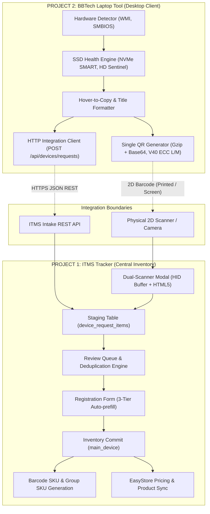

# ITMS & BBTech Laptop Tool: Master Architecture Blueprint & Kickstart Guide

**Document Version:** `2.0`  
**Target Audience:** Software Engineers, QA Engineers, DevOps, ITMS Operators  
**Last Updated:** October 30, 2026  
**Status:** Canonical Reference Blueprint  

---

## 1. Executive Blueprint: System Topology

This ecosystem consists of **two independent, decoupled software systems** operating under a strict integration contract:



### Strict Project Boundaries:
| Attribute | Project 1: ITMS | Project 2: BBTech Laptop Tool |
|---|---|---|
| **Repository Path** | `C:\...\H001_TrackerApp\inventory-management-system` | `C:\...\BBTech Laptop Tool Latest` |
| **Technology Stack** | Next.js 15, React 19, TypeScript, Supabase (PostgreSQL), Vitest | .NET Framework 4.7.2, C#, WPF, WMI, NUnit / MSTest |
| **Primary Role** | Central inventory tracking, review queue, SKU generation, sales, EasyStore sync | Laptop hardware detection, component stress tests, SSD/Battery health, QR export |
| **Separation Rule** | Never move Laptop Tool code into ITMS. | Never move ITMS web code into Laptop Tool. |

---

## 2. Quickstart: Zero to Running in 3 Minutes

### Starting Project 1 (ITMS Web Application)

Open a terminal in `inventory-management-system`:
```powershell
cd "C:\Users\TOUHIDUL ISLAM RUKON\Desktop\Project\H001_TrackerApp\inventory-management-system"

# 1. Start Mock Supabase (Port 54321) if developing locally without cloud Supabase:
node scripts/mock-supabase.js

# 2. In a second terminal, start Next.js Dev Server (Port 8000):
npm run dev

# 3. Access web dashboard:
# http://localhost:8000/devices/requests (Review Queue)
# http://localhost:8000/devices (Main Inventory)
```

### Starting Project 2 (BBTech Laptop Tool)

Open a PowerShell terminal in `BBTech Laptop Tool Latest`:
```powershell
cd "C:\Users\TOUHIDUL ISLAM RUKON\Desktop\Project\BBTech Laptop Tool Latest"

# Run tests:
powershell -ExecutionPolicy Bypass -File build/build.ps1 -TestOnly

# Build production standalone executable:
powershell -ExecutionPolicy Bypass -File build/build.ps1

# The standalone output executable is located at:
# dist\release\BBTech Laptop Tool.exe
```

---

## 3. Operational Blueprint: End-to-End Workflow

```
[1. Laptop Detection] ──> [2. Diagnostics & SSD Health] ──> [3. QR / HTTP Export]
                                                                     │
                                                                     ▼
[6. Inventory & SKU]  <── [5. Auto-prefill & Approval] <── [4. ITMS Intake Scan]
```

### Step 1: Hardware Detection on Client Laptop
1. Launch `BBTech Laptop Tool.exe` on target laptop.
2. The tool automatically detects hardware via WMI and low-level SMBIOS:
   - Manufacturer, Brand, Product Family, Model Number.
   - CPU specifications (Cores, Clock speed, Full name, Generation).
   - Memory modules (Slot, Speed, Capacity, Type).
   - Battery health retention (`health_percent`, cycle count, charge capacity).

### Step 2: SSD Health Diagnostics
- The `SsdHealthEngine` reads wear percent, S.M.A.R.T. status, power-on hours, and drive temperature.
- Formats health metric: `"<Percentage>% (<Status>)"` (e.g., `98% (Healthy)`).
- If low-level permissions are needed, `ElevationHelper` provides seamless UAC elevation.

### Step 3: Export via Single QR Code or Network Dispatch
- **Method A (Offline Single QR):**
  - Technician clicks **QR Code**.
  - Payload is compressed with Gzip, framed as `BBTECH:GZ1:<base64>`, and rendered as a **single high-density Version 40 QR code** using adaptive ECC (Level M or Level L).
  - No multipart QR navigation needed.
- **Method B (Online Direct Send):**
  - Technician clicks **Send to ITMS**.
  - Tool dispatches `POST /api/devices/requests` with `x-itms-api-key` header.
  - Generates idempotent `request_id` preventing accidental double-submissions.

### Step 4: ITMS Intake (Dual-Mode Scanner)
1. In ITMS, navigate to **Review Queue** (`/devices/requests`) and click **Scan Inspection QR**.
2. **Scanner Mode 1 (Physical 2D Barcode Scanner):**
   - Connect any standard USB/Bluetooth handheld 2D barcode scanner (configured in HID keyboard mode).
   - Scan the QR code displayed on the laptop screen or printed sheet.
   - The scanner buffers rapid input (<50ms inter-keystroke) terminated by Enter, automatically parses `BBTECH:GZ1:...`, and opens the inspection intake modal.
3. **Scanner Mode 2 (Webcam / Smartphone Camera):**
   - Click **Camera Scan**.
   - Grants camera permission, selects rear environment camera, supports torch toggle, and detects QR instantly.

### Step 5: Duplicate Detection & Review
- ITMS checks hardware serial (`hw_serial`), motherboard serial (`board_serial`), and `system_uuid` against `main_device`.
- Displays status badge:
  - `Ready / No Match`: Laptop is clean new stock.
  - `Possible Duplicate`: Laptop serial already exists in inventory (allows linking or updating specs).

### Step 6: Registration Form & 3-Tier Classification Auto-population
Clicking **Approve as New Device** opens the intake form:
- **3-Tier Device Classification Auto-prefilled:**
  - **Brand:** `ref_brands` (e.g. `Lenovo`)
  - **Model:** `ref_models` Product Family (e.g. `ThinkPad`)
  - **Model Number:** `model_number` (e.g. `T14 Gen 2`)
- **Inspection Metrics Auto-prefilled:**
  - CPU, Generation, RAM, Storage.
  - Battery Health (`battery_health`).
  - SSD Health (`ssd_health`).
- **Preserved Existing Fields:**
  - `category_id` (Product Category)
  - `source_id` (Preserved existing Source channels)
  - `supplier_id` (Optional vendor entity)
  - `purchase_cost` (Defaults to configured intake setting, e.g. RM 250)
  - `selling_cost`, `shelf`, `notes`, `status`

### Step 7: Inventory Commit & SKU Rules Execution
On clicking **Approve & Save to Inventory**:
1. Creates new record in `main_device`.
2. Automatically generates SKUs:
   - **Barcode SKU:** `LNTPI511G32G512` (Rule-token concatenation without separators).
   - **Group SKU:** `LN-TP-I5-11G-32G-512` (Hyphen-separated grouping key).
   - **Device Name:** `Lenovo ThinkPad T14 Gen 2 Intel Core i5 11th Gen`.
3. Enables **Print Label** button for direct label printing.
4. Synchronizes with EasyStore variant lookup based on `group_sku_key`.

---

## 4. Codebase Directory Blueprint

### Project 1: ITMS (`inventory-management-system`)
```
inventory-management-system/
├── app/
│   ├── (dashboard)/
│   │   ├── devices/
│   │   │   ├── [id]/page.tsx              # Device Details page (Tabs: Device, Sale, Warranty)
│   │   │   ├── requests/page.tsx          # Review Queue dashboard
│   │   │   └── new/page.tsx               # New device registration page
│   └── api/devices/requests/
│       ├── route.ts                       # POST intake / GET queue
│       ├── [id]/route.ts                  # GET inspection details
│       └── [id]/review/route.ts           # POST review decisions (approve, update, link)
├── components/
│   ├── ui/
│   │   ├── FormField.tsx                  # Dynamic form field with detected model warning badge
│   │   └── Scanner.tsx                    # Dual-mode scanner (Physical HID buffer + Camera)
│   ├── lookup/
│   │   ├── ModelLookupButton.tsx          # Scoped quick-add modal for new Model families
│   │   └── LookupModalProvider.tsx        # Toast feedback and modal contexts
│   └── drawers/tabs/
│       └── DeviceTab.tsx                  # Device Details drawer tab (Device, Inspection, Financial, etc.)
├── features/
│   ├── devices/
│   │   ├── components/DeviceNew.tsx       # Intake & receiving form with prefill lifecycle
│   │   ├── config/receiving-fields.ts     # Field order configuration
│   │   ├── types/device-definitions.ts    # Field definitions and group mappings
│   │   └── utils/device-utils.ts          # Barcode SKU, Group SKU & Device Name generators
│   └── requests/
│       ├── components/
│       │   ├── InspectionQrScannerModal.tsx # Full QR scanner modal
│       │   └── RequestDetailModal.tsx       # Inspection details view & review trigger
│       ├── services/request-service.ts    # Duplicate detection & approval engine
│       └── utils/lookup-match.ts          # 3-tier classification multi-strategy matcher
├── lib/
│   ├── qr/qr-decoder.ts                   # Gzip decompressor & payload parser
│   └── offline/inspection-store.ts        # IndexedDB offline storage & sync
└── supabase/
    └── migrations/
        └── 20261030160000_device_classification_and_ssd_health.sql # Supabase migration
```

### Project 2: BBTech Laptop Tool (`BBTech Laptop Tool Latest`)
```
BBTech Laptop Tool Latest/
├── src/
│   ├── BBTech.Core/
│   │   ├── Integration/ItmsIntegration.cs # HTTP REST client & payload builder
│   │   ├── Models/DetectionResult.cs      # Core hardware data models
│   │   ├── Parsing/BrandCatalog.cs        # Brand & product family detection catalog
│   │   ├── Qr/QrCodeEncoder.cs            # Version 40 Byte Mode with adaptive ECC L/M
│   │   ├── Qr/QrPayloadCompressor.cs      # Gzip canonical compression pipeline
│   │   └── Storage/SsdHealthModels.cs     # Storage health data structures
│   └── BBTech.LaptopTool/
│       ├── Detect/HardwareDetector.cs     # WMI, BIOS & hardware detection orchestration
│       ├── Services/ElevationHelper.cs    # UAC Administrator elevation helper
│       ├── Services/SsdHealthEngine.cs    # NVMe SMART & HD Sentinel health parser
│       └── UI/Views/
│           ├── DetectView.xaml            # Main detection cards with Hover-to-Copy
│           ├── DetectView.xaml.cs         # Event handlers & clipboard feedback
│           └── QrCodeWindow.cs            # QR code display window
├── build/build.ps1                        # Standalone build & test script
└── dist/release/BBTech Laptop Tool.exe    # Standalone production executable
```

---

## 5. Standard Device Classification Matrix

| Brand (`ref_brands`) | Product Family (`ref_models`) | Example Model Numbers (`model_number`) | Barcode SKU Prefix |
|---|---|---|---|
| **Lenovo** (ID: 1, `LN`) | `ThinkPad` (`TP`) | `T14 Gen 2`, `X1 Carbon Gen 9`, `L13 Yoga` | `LNTP...` |
| | `IdeaPad` (`IP`) | `3 15ITL6`, `5 14ALC05`, `Gaming 3` | `LNIP...` |
| | `Yoga` (`YG`) | `Slim 7`, `7 14ITL5` | `LNYG...` |
| | `Legion` (`LG`) | `5 15ACH6H`, `7 16ITHg6` | `LNLG...` |
| **Dell** (ID: 2, `DL`) | `Latitude` (`LAT`) | `5420`, `7420`, `3520` | `DLLAT...` |
| | `XPS` (`XPS`) | `13 9310`, `15 9510` | `DLXPS...` |
| | `Precision` (`PREC`) | `3561`, `5560`, `7560` | `DLPREC...` |
| | `Inspiron` (`INSP`) | `15 3511`, `14 5410` | `DLINSP...` |
| | `Vostro` (`VOST`) | `3400`, `3510`, `5510` | `DLVOST...` |
| **HP** (ID: 3, `HP`) | `EliteBook` (`EB`) | `840 G8`, `830 G7`, `850 G6` | `HPEB...` |
| | `ProBook` (`PB`) | `440 G8`, `450 G8`, `640 G5` | `HPPB...` |
| | `ZBook` (`ZB`) | `Firefly 14 G8`, `Power G8` | `HPZB...` |
| | `Pavilion` (`PAV`) | `15-eg0000`, `x360 14` | `HPPAV...` |
| | `Envy` (`ENVY`) | `13-ba1000`, `15-ep0000` | `HPENVY...` |
| **ASUS** (ID: 5, `AS`) | `ZenBook` (`ZB`) | `UX3402`, `UX425`, `Duo 14` | `ASZB...` |
| | `VivoBook` (`VB`) | `S15 S533`, `15 OLED` | `ASVB...` |
| | `ExpertBook` (`EXPB`)| `B9450`, `B1400` | `ASEXPB...` |
| | `ROG` (`ROG`) | `Zephyrus G14`, `Strix G15` | `ASROG...` |
| | `TUF` (`TUF`) | `Gaming F15`, `A15` | `ASTUF...` |
| **Acer** (ID: 6, `AC`) | `Aspire` (`ASP`) | `A515-56`, `A315-58` | `ACASP...` |
| | `Swift` (`SWF`) | `3 SF314-511`, `5 SF514-55T` | `ACSWF...` |
| | `Nitro` (`NIT`) | `5 AN515-57` | `ACNIT...` |

---

## 6. Database Migration Blueprint

To initialize or update the Supabase database schema for device classification and SSD health, execute the migration:  
`supabase/migrations/20261030160000_device_classification_and_ssd_health.sql`

```sql
-- 1. Add SSD Health columns
ALTER TABLE IF EXISTS public.device_request_items ADD COLUMN IF NOT EXISTS ssd_health text;
ALTER TABLE IF EXISTS public.main_device ADD COLUMN IF NOT EXISTS ssd_health text;

-- 2. Seed Brands if missing
INSERT INTO public.ref_brands (id, name, code)
VALUES 
    (5, 'ASUS', 'AS'),
    (6, 'Acer', 'AC')
ON CONFLICT (id) DO NOTHING;

-- 3. Seed Standard Product Families (Brand -> Product Family)
-- Lenovo (1), Dell (2), HP (3), ASUS (5), Acer (6)
INSERT INTO public.ref_models (id, brand_id, name, code)
VALUES 
    (101, 1, 'ThinkPad', 'TP'),
    (102, 1, 'IdeaPad', 'IP'),
    (103, 1, 'Yoga', 'YG'),
    (104, 1, 'Legion', 'LG'),
    (201, 2, 'Latitude', 'LAT'),
    (202, 2, 'XPS', 'XPS'),
    (203, 2, 'Precision', 'PREC'),
    (204, 2, 'Inspiron', 'INSP'),
    (205, 2, 'Vostro', 'VOST'),
    (301, 3, 'EliteBook', 'EB'),
    (302, 3, 'ProBook', 'PB'),
    (303, 3, 'ZBook', 'ZB'),
    (304, 3, 'Pavilion', 'PAV'),
    (305, 3, 'Envy', 'ENVY'),
    (501, 5, 'ZenBook', 'ZB'),
    (502, 5, 'VivoBook', 'VB'),
    (503, 5, 'ROG', 'ROG'),
    (504, 5, 'TUF', 'TUF'),
    (505, 5, 'ExpertBook', 'EXPB'),
    (601, 6, 'Aspire', 'ASP'),
    (602, 6, 'Swift', 'SWF'),
    (603, 6, 'Spin', 'SPN'),
    (604, 6, 'Nitro', 'NIT'),
    (605, 6, 'Predator', 'PRED')
ON CONFLICT (id) DO NOTHING;
```

---

## 7. Verification & Automated Test Commands

### Running ITMS Tests:
```powershell
cd "C:\Users\TOUHIDUL ISLAM RUKON\Desktop\Project\H001_TrackerApp\inventory-management-system"
npm test -- --run
# Result: 16 test files passed (164/164 tests)

npm run lint
# Result: 0 errors
```

### Running Laptop Tool Tests:
```powershell
cd "C:\Users\TOUHIDUL ISLAM RUKON\Desktop\Project\BBTech Laptop Tool Latest"
powershell -ExecutionPolicy Bypass -File build/build.ps1 -TestOnly
# Result: 658/658 tests passed
```

---

## 8. Git Remotes & Branch Reference

| Project | Branch | Local Directory | Remote Repository URL |
|---|---|---|---|
| **ITMS** | `feat/bbtech-laptop-tool-integration` | `H001_TrackerApp` | `https://github.com/tirukon015/inventoryms.git` (and `devbbtech/H001_TrackerApp`) |
| **Laptop Tool** | `fix/itms-integration-e2e` | `BBTech Laptop Tool Latest` | `https://github.com/tirukon015/bbtech-laptop-tool.git` |
