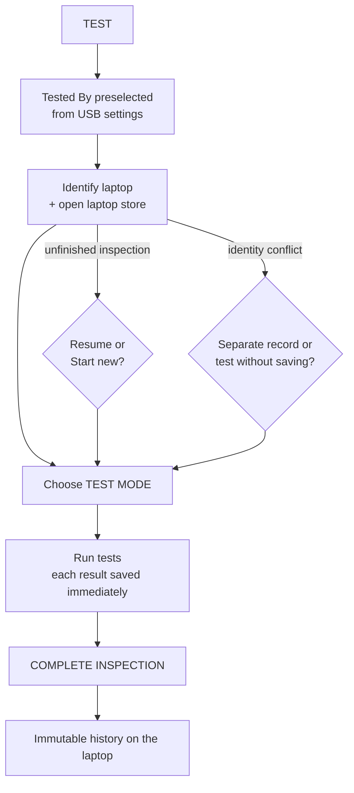

# TEST / QC

Primary users: QC staff. Source: `UI/Views/TestView.xaml(.cs)`, `Services/InspectionManager.cs`, `Test/TestSession.cs`, `src/BBTech.Core/Testing/*`, `UI/Tests/*`.

## 1. Workflow

## 2. Tested By (operator)

- The operator is chosen once in **TESTED BY** and saved on the USB, so it stays selected for the next laptops and after restarts.
- Changing it affects **new** inspections only. An inspection in progress keeps the name and role of the person who started it.
- Running a test without a selected operator prompts the user to choose one. If no operators exist, an admin must add them first.

See [OPERATOR-MANAGEMENT.md](OPERATOR-MANAGEMENT.md).

## 3. Test modes

| Mode | Selected tests |
|---|---|
| **REQUIRED** (default for each new inspection) | **Display, Sound, Keyboard, Battery**: mandatory and cannot be removed. **+ Add Tests** adds any other test; added tests can be removed. |
| **ALL TESTS** | Every test in the catalog. It is built from the `HardwareTest` enum, so tests added in future versions are included automatically. |

- **Leaving ALL TESTS:** removing a test turns the plan into REQUIRED mode with the remaining selection. Clicking REQUIRED resets to the four required tests.
- **Removing a test that has a result:** asks for confirmation. The test is then recorded as "removed from this inspection" and is not counted.

### Tests implemented

| Test | Verification |
|---|---|
| Display | Full-screen colour, gradient and grid patterns, plus an operator checklist |
| Sound (speaker) | Left-only and right-only tones, both, frequency sweep, and the BBTech test media played inside the app, plus a checklist |
| Keyboard | Raw key messages; tested keys turn green; left/right Shift, Ctrl and Alt are distinguished; optional numeric keypad |
| Battery | BatteryInfoView health plus live charger unplug → re-plug detection |
| Touchpad | 12×6 coverage grid, left click, right click, double tap, scroll up/down |
| Camera | DirectShow live preview inside the app; Windows Camera app as a fallback |
| Microphone | Live level meter, plus a 5-second recording played back |
| Headphone | Headphone output detection (Core Audio endpoints) and left/right tones |
| USB | Each real plug-in event marks one port as WORKING; the BBTech USB's own port counts |
| Wi-Fi | Adapter, radio state, connection, and an active scan for networks |
| Bluetooth | Adapter plus a device inquiry scan |
| Storage / SSD | Windows health, Windows reliability counters when available, optional HD Sentinel report |

No test passes automatically: the operator decides **PASS**, **FAIL** or **SKIP**, and panels only show what they measured. A "charger" test does not exist as a separate test; the charger check is part of Battery.

## 4. Statuses and overall result

- **Test status:** NOT TESTED · TESTING · PASS · FAIL · SKIPPED. Always shown as text, not only colour.
- **Overall** (`OverallResultCalculator`, selected tests only):
  - any FAIL gives **FAIL**;
  - every selected test PASS gives **PASS**;
  - anything else (NOT TESTED, TESTING, SKIPPED) gives **INCOMPLETE**.

In REQUIRED mode, a missing or failed required test therefore always prevents PASS.

## 5. Inspection lifecycle

| Stage | What happens |
|---|---|
| Start | Created on the first recorded result: number (1, 2, 3… per laptop), operator snapshot, test mode, selected tests, app version, hardware summary |
| Each result | Appended to the encrypted journal and flushed to disk immediately |
| Selection change | Mode and selected tests are updated on the open inspection immediately |
| **Start over** | The open inspection is closed as **ABANDONED** (kept in history), and a new session starts |
| **COMPLETE INSPECTION** | A confirmation shows the overall result, test mode, operator and any tests not completed. On confirm: final selection, results and overall are saved, a sync record in state `LOCAL` is added, and the inspection becomes **immutable** |
| Next session | A new inspection (#N+1); earlier ones are never overwritten |

## 6. Recovery after interruption

If the app closes or crashes, the laptop loses power or the USB is pulled, the inspection remains **IN_PROGRESS** on the laptop. The next TEST on that laptop shows "Unfinished inspection found" with the operator, start time and number of saved results:

- **Resume:** reloads the saved results, test mode and selection.
- **Start new inspection:** the old one is kept as ABANDONED.

Tests cannot start until the laptop is identified and this decision is made.

## 7. When results cannot be saved

A banner explains the cause, and testing and export still work:
- the laptop reports no identifiers;
- staff chose to test without saving after an identity conflict;
- the laptop store cannot be opened.
